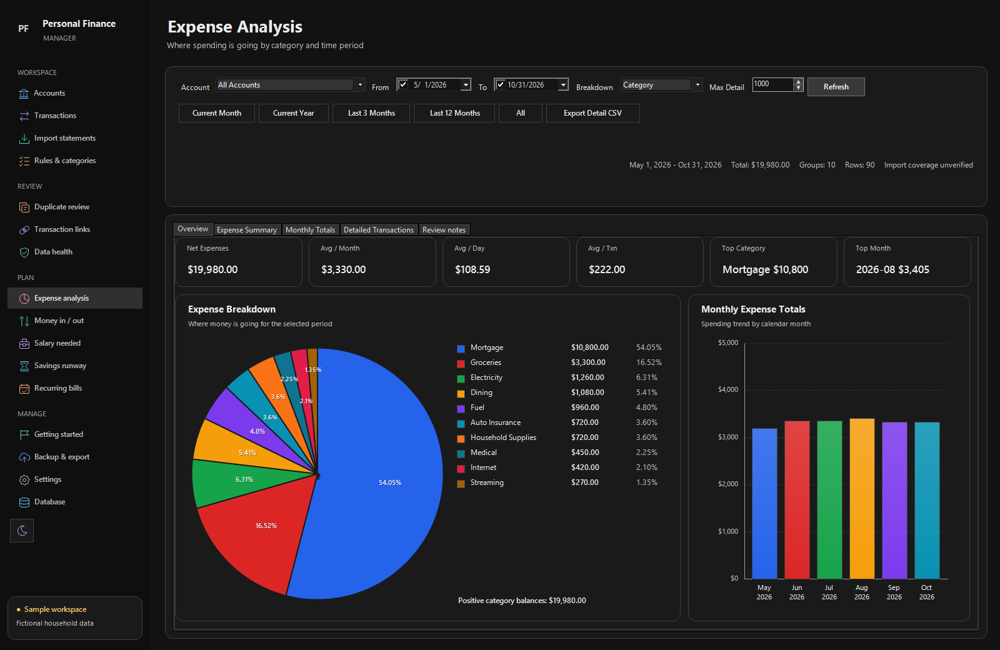
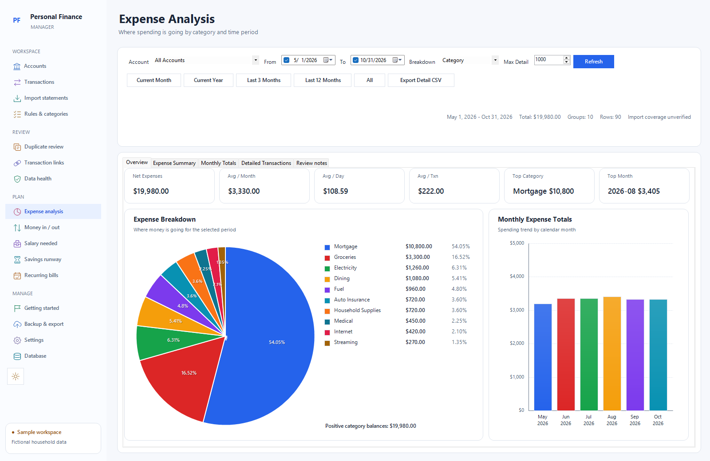
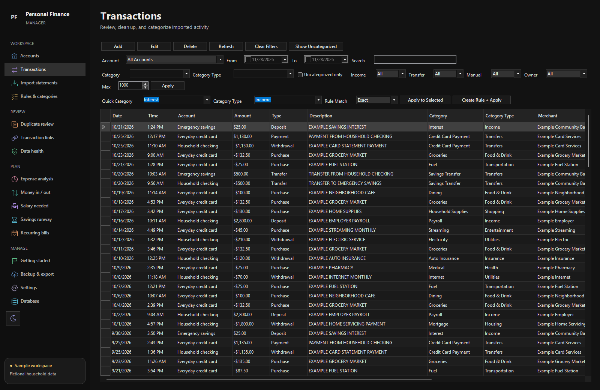
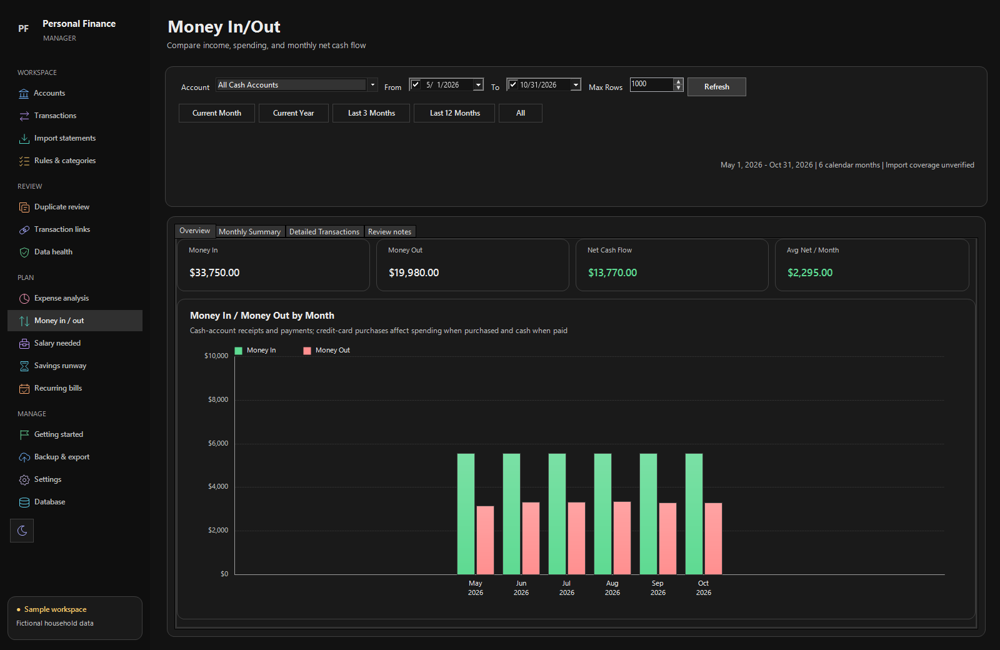
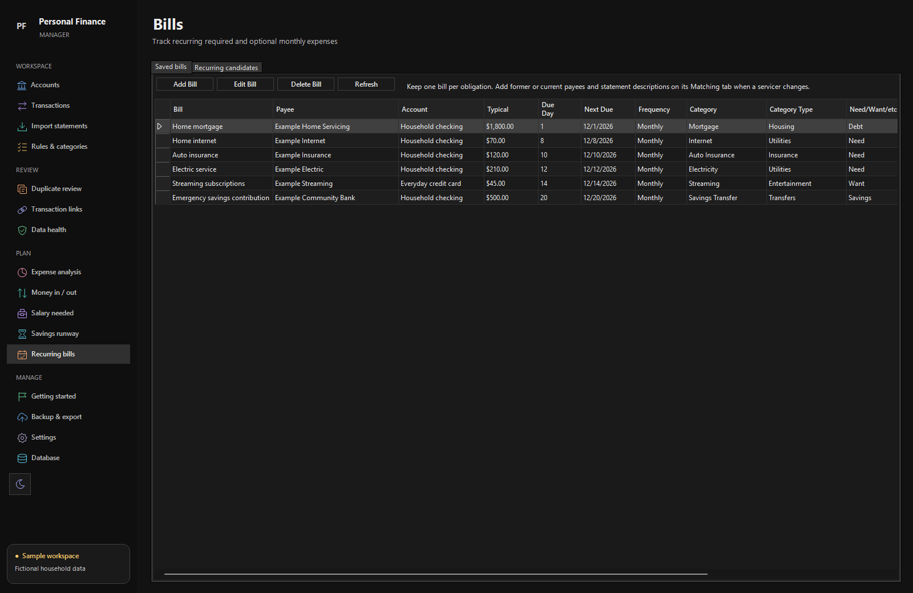
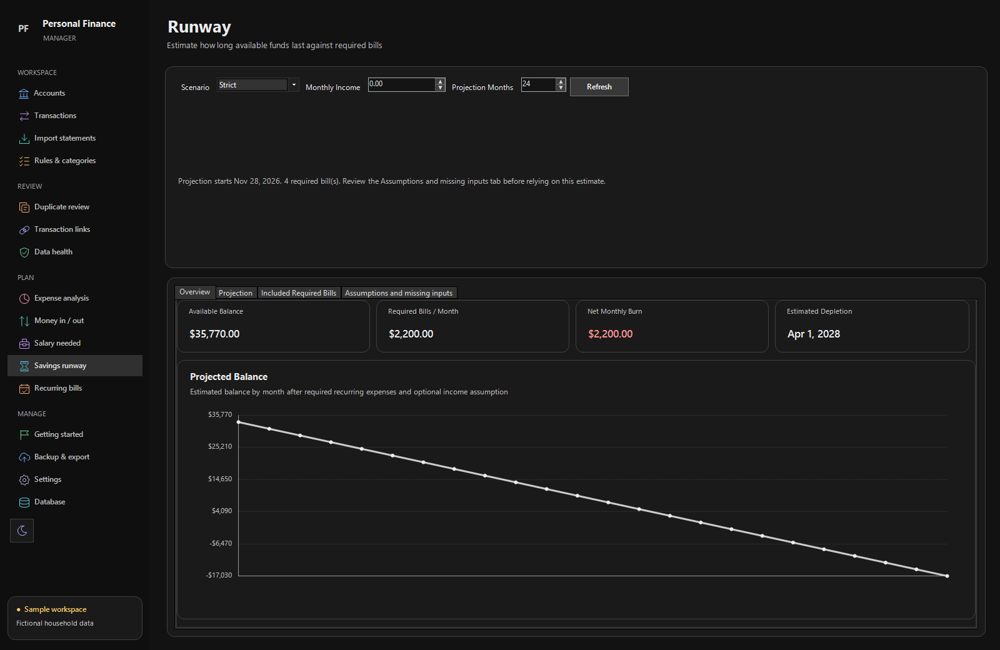

# Application gallery

Explore the application's transaction review, financial reports, and planning tools in light and dark themes. All screenshots use fictional sample data.

Select an image to view it at full size.

## Expense analysis

Spending totals, category breakdowns, and monthly trends help explain where money goes. Both themes show the same account activity and date range.

### Dark theme

### Light theme

## Transactions

Review income, purchases, transfers, and repayments across imported accounts. Account, date, category, and text filters narrow the table; quick categorization and rule creation are available above it.

## Cash flow

Compare income, outflow, and monthly net cash flow across cash accounts, with transfers and credit-card payments handled according to their financial role.

## Recurring bills

Track planned payments, due dates, and required or optional expenses. Keep one recurring obligation when a mortgage or other bill changes providers.

## Savings runway

Project available funds against required bills and the selected income scenario. The application also exposes the assumptions and missing inputs used for the estimate.

